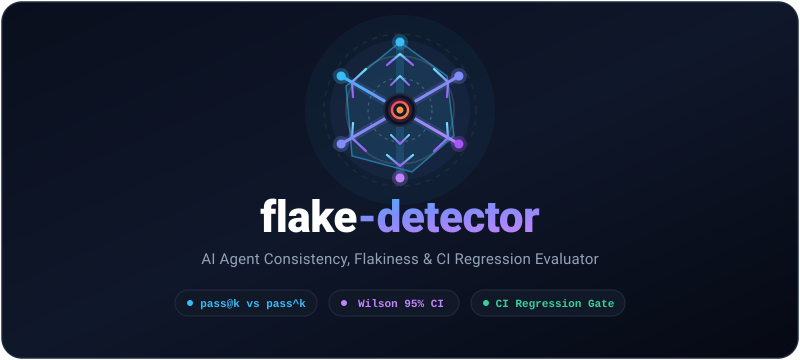

<p align="center">
  
</p>

<p align="center">
  <strong>Quantify consistency, reveal flakiness, and gate CI for AI agents.</strong>
</p>

<p align="center">
  <a href="https://github.com/loksai-codes/flake-detector"></a>
  <a href="LICENSE"></a>
  <a href="https://github.com/astral-sh/ruff"></a>
  <a href="https://pytest.org"></a>
  <a href="https://groq.com"></a>
</p>

---

## 💡 The Problem: Single-Run Evaluations Lie

Most AI agent evaluations report a single number from a single run:

> *"The agent passed 8 out of 10 tasks (80% accuracy)."*

Because LLMs and autonomous agents are non-deterministic, a single run conceals critical variance:
- A task that passes once but fails four other times looks like a complete success.
- Teams celebrate agents that "worked in the demo" only to watch them fail inconsistently in production.
- Prompt tweaks and model swaps often produce lucky runs that masquerade as genuine improvements.

**`flake-detector`** runs an AI agent across an evaluation suite $N$ times and computes true statistical consistency. It exposes the widening gap between **"can succeed"** (`pass@k`) and **"always succeeds"** (`pass^k`), flags flaky tasks with Wilson 95% confidence intervals, and provides a statistical regression check that can fail a CI build when a prompt change degrades dependability.

---

## ⚡ Quickstart

### 1. Installation

Clone and install `flake-detector` in editable mode:

```bash
git clone https://github.com/loksai-codes/flake-detector.git
cd flake-detector
python -m venv .venv
source .venv/bin/activate  # Windows: .venv\Scripts\activate
pip install -e ".[dev]"
```

### 2. Run the Simulated Demo (Zero Cost, No Key Required)

Run the included 12-task simulation suite 20 times per task with $k=5$:

```bash
flake run --suite suites/demo_sim.yaml --agent sim --runs 20 --k 5 --seed 42
```

Outputs will be saved atomically to `results/<run_id>.json`.

### 3. Generate Reports & Charts

Generate a rich Markdown report and Matplotlib consistency charts:

```bash
flake report results/2026-10-26T11-30-00_demo-sim_sim.json --out report.md --charts-dir charts/
```

### 4. Regression Check in CI

Compare two evaluation runs to detect significant regressions:

```bash
flake compare results/baseline.json results/candidate.json --fail-on-regression
```

---

## 📐 Concepts & Mathematical Rigor

### 1. Wilson 95% Confidence Interval
Standard Wald intervals ($\hat{p} \pm z\sqrt{\hat{p}(1-\hat{p})/n}$) fail dramatically near 0% and 100% or on small sample sizes. `flake-detector` uses the **Wilson score interval** ($z = 1.96$):

$$\text{center} = \frac{p + \frac{z^2}{2n}}{1 + \frac{z^2}{n}}, \quad \text{half} = \frac{z \sqrt{\frac{p(1-p)}{n} + \frac{z^2}{4n^2}}}{1 + \frac{z^2}{n}}$$

$$\text{Interval} = \left[\max(0, \, \text{center} - \text{half}), \; \min(1, \, \text{center} + \text{half})\right]$$

### 2. `pass@k` vs `pass^k`: The Dependability Gap

For a task with $n$ runs and $c$ successes:

- **$\text{pass}@k$ (Optimistic):** Probability that at least one of $k$ sampled runs succeeds (*"Can the agent solve this?"*):
  $$\text{pass}@k = 1 - \frac{\binom{n-c}{k}}{\binom{n}{k}} \quad (\text{equals } 1.0 \text{ if } n - c < k)$$

- **$\text{pass}^k$ (Dependable):** Probability that **all** $k$ sampled runs succeed (*"Can we rely on this agent?"*):
  $$\text{pass}^k = \frac{\binom{c}{k}}{\binom{n}{k}} \quad (\text{equals } 0.0 \text{ if } c < k)$$

#### Worked Example ($n=10, c=3$)

Consider a flaky task that succeeded in 3 out of 10 runs:

| $k$ | $\text{pass}@k$ (Can succeed) | $\text{pass}^k$ (Always succeeds) | The Dependability Reality |
|:---:|:---:|:---:|:---|
| **$k=1$** | $0.3000$ | $0.3000$ | Base success rate is 30%. |
| **$k=2$** | $0.5333$ | $0.0667$ | Given 2 attempts, it might succeed half the time, but only 6.7% reliable. |
| **$k=5$** | **$0.9167$** | **$0.0000$** | With 5 attempts, it has a 92% chance to pass at least once, but **0%** chance of consistency! |

### 3. Flakiness Score & Task Status
- **Flakiness Score:** $4 \cdot p \cdot (1 - p)$ (ranges from $0.0$ for strictly consistent/failing tasks up to $1.0$ at maximum uncertainty $p=0.5$).
- **Task Status:**
  - `consistent`: $c = n$ (100% success rate across all runs)
  - `failing`: $c = 0$ (0% success rate)
  - `flaky`: $0 < c < n$ (intermittent success)

---

## 🛠️ CLI Reference

```
Usage: flake [OPTIONS] COMMAND [ARGS]...

Commands:
  run      Execute an evaluation suite with an agent N times per task.
  report   Generate Markdown report and Matplotlib consistency charts.
  compare  Compare two runs and detect statistical regressions.
```

### `flake run`
```bash
flake run --suite PATH \
          --agent sim|groq \
          --runs 20 \
          --k 5 \
          --seed 42 \
          [--workers 8] \
          [--out results/] \
          [--resume] \
          [--max-rpm 20] \
          [--model llama-3.3-70b-versatile]
```

- `--resume`: Skips runs already recorded in the results file (resilience against rate-limits).
- `--seed`: Ensures seed derivation is bit-for-bit deterministic regardless of worker thread concurrency.

### `flake report`
```bash
flake report results/run.json --out report.md --charts-dir charts/
```
Generates:
1. `pass_curves.png`: Plots mean $\text{pass}@k$ and $\text{pass}^k$ for $k=1..K$, visually shading the flakiness gap.
2. `task_rates.png`: Horizontal bar chart of per-task success rates with Wilson 95% error bars sorted by performance.
3. Formatted Markdown tables with failure reason breakdowns.

### `flake compare`
```bash
flake compare baseline.json candidate.json [--alpha 0.05] [--fail-on-regression]
```
- Performs a per-task non-overlapping Wilson interval test.
- Computes a paired bootstrap test over tasks (1000 resamples, fixed seed) on the difference in mean success rate.
- **Exit code 0:** No regression detected.
- **Exit code 1:** Significant regression detected (only when `--fail-on-regression` is set).
- **Exit code 2:** Config or schema validation error.

---

## 🤖 Running with Groq

`flake-detector` includes a first-class agent adapter for Groq's high-speed OpenAI-compatible API:

1. **Obtain an API key** from [console.groq.com](https://console.groq.com).
2. **Configure environment:**
   ```bash
   cp .env.example .env
   # Add your key to .env:
   # GROQ_API_KEY=gsk_...
   # GROQ_MODEL=llama-3.3-70b-versatile
   ```
3. **Run Groq evaluation:**
   ```bash
   flake run --suite suites/demo_groq.yaml --agent groq --runs 10 --k 3 --max-rpm 20
   ```

### Built-in Robustness
- **Safe Tools:** Includes an AST-based calculator (safe arithmetic without `eval`/`exec`) and factual lookup tools.
- **Rate-Limit Handling:** Token-bucket `--max-rpm` throttling and exponential backoff retry (base 1s, factor 2, max 30s) honoring HTTP 429 `Retry-After` headers.
- **Secrets Security:** API keys are never stored in results JSON, logs, or commit histories.

---

## 📊 Results with Groq

> *Note: Benchmark numbers should never be fabricated. Below is the experimental ledger to record real empirical runs:*

| Date | Suite | Model | Runs ($n$) | $k$ | Mean $\text{pass}@1$ | Mean $\text{pass}^k$ | Consistent | Flaky | Failing |
|:---:|:---:|:---:|:---:|:---:|:---:|:---:|:---:|:---:|:---:|
| *TODO* | `demo_groq.yaml` | `llama-3.3-70b-versatile` | 10 | 3 | *TODO* | *TODO* | *TODO* | *TODO* | *TODO* |
| *TODO* | `demo_groq.yaml` | `llama-3.1-8b-instant` | 10 | 3 | *TODO* | *TODO* | *TODO* | *TODO* | *TODO* |

---

## 🏗️ Repository Architecture

```text
flake-detector/
├── .github/workflows/ci.yml # GitHub Actions CI matrix (Python 3.11, 3.12)
├── assets/logo.svg          # Project branding
├── examples/                # Sample evaluation results and generated reports
│   ├── sample_results.json
│   ├── sample_report.md
│   └── charts/
├── prompts/                 # Guided build milestones (00 to 05)
├── suites/                  # YAML evaluation suites
│   ├── demo_sim.yaml        # 12-task simulation suite (math, formatting, reasoning)
│   └── demo_groq.yaml       # 10-task Groq tool-use suite
├── src/flake_detector/
│   ├── models.py            # Pydantic v2 schemas
│   ├── metrics.py           # Wilson intervals, pass@k, pass^k, suite summary
│   ├── grading.py           # Deterministic graders (exact, contains, regex, numeric)
│   ├── suite.py             # YAML loader with sha256_12 provenance
│   ├── runner.py            # Concurrent execution engine & resume support
│   ├── storage.py           # Atomic JSON persistence
│   ├── report.py            # Markdown reporter & Matplotlib charts
│   ├── compare.py           # Regression comparator with paired bootstrap
│   ├── cli.py               # Typer CLI application
│   └── agents/
│       ├── base.py          # Agent protocol
│       ├── simulated.py     # Deterministic simulation agent
│       ├── groq_agent.py    # Groq OpenAI-compatible tool agent
│       └── tools.py         # AST calculator and lookup tools
└── tests/                   # Pytest test suite (100% offline, zero network in CI)
```

---

## 🔒 Security & Privacy

- `.env` is strictly `.gitignore`d.
- Results files contain run metadata, timings, prompts, and answers, but **never secrets or API keys**.
- The safe calculator operates via Python's `ast` parser, prohibiting code injection, arbitrary attribute lookups, or system calls.

---

## 📄 License

Distributed under the **MIT License**. See [`LICENSE`](LICENSE) for more information.
