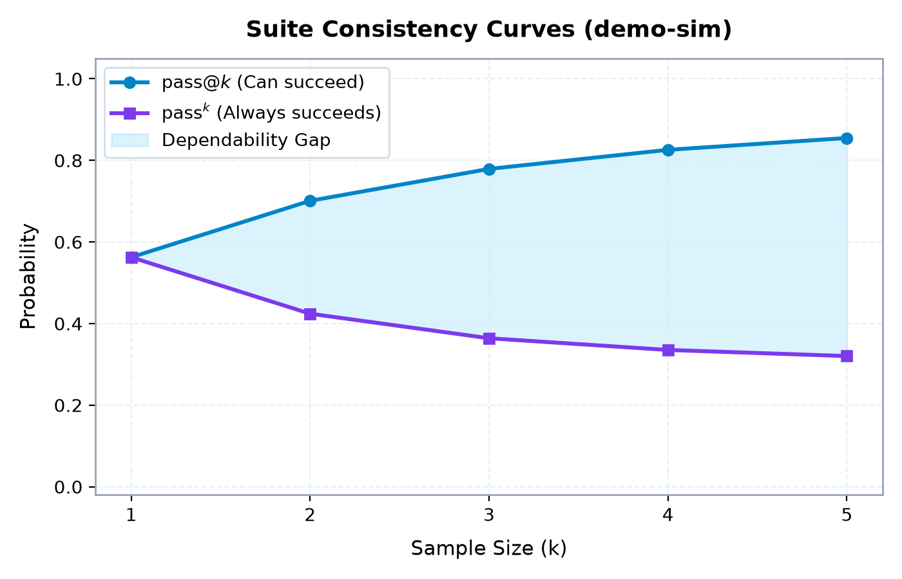

<p align="center">
  
</p>

<p align="center">
  <strong>Quantify consistency, reveal flakiness, and gate CI for AI agents.</strong>
</p>

<p align="center">
  <a href="https://github.com/loksai-codes/flake-detector"></a>
  <a href="LICENSE"></a>
  <a href="https://github.com/astral-sh/ruff"></a>
  <a href="https://pytest.org"></a>
  <a href="https://groq.com"></a>
</p>

---

## 💡 The Problem: Single-Run Evaluations Lie

Most AI agent evaluations report a single aggregate number: *"The agent passed 8 out of 10 tasks (80%)."* Because LLMs and autonomous agents are non-deterministic, single-run benchmarks conceal critical variance: a task that passes once but fails four other times looks like a complete success. Teams ship agents that "worked in the demo" only to watch them fail intermittently in production, while prompt tweaks that merely got lucky are mistaken for genuine improvements.

**`flake-detector`** runs your agent suite $N$ times and computes rigorous consistency statistics: per-task Wilson 95% confidence intervals, the gap between **can succeed** (`pass@k`) and **always succeeds** (`pass^k`), and an automated regression gate for CI pipelines.

---

## ⚡ Quickstart

### 1. Installation

```bash
git clone https://github.com/loksai-codes/flake-detector.git
cd flake-detector
python -m venv .venv
# Linux / macOS:
source .venv/bin/activate
# Windows:
.venv\Scripts\activate
pip install -e ".[dev]"
```

### 2. Run the Simulated Demo (Zero Cost, No Key Required)

Run the included 12-task simulation suite 20 times per task with $k=5$:

```bash
flake run --suite suites/demo_sim.yaml --agent sim --runs 20 --k 5 --seed 42 --out results/
```

### 3. View the Report & Visualizations

```bash
flake report results/2026-10-26T06-58-22_demo-sim_sim.json --out report.md --charts-dir charts/
```

---

## 📊 What You Get (*Simulated Data*)

When evaluating agents, `flake-detector` generates publication-quality Matplotlib consistency charts and an actionable Markdown audit report.

<p align="center">
  
</p>

### Report Excerpt (`demo-sim` — 12 tasks, $n=20$, $k=5$)

> *The following data represents an actual execution of the simulated agent (`examples/sample_report.md`):*

- **Mean pass@1 (Success Rate):** 56.2%
- **Mean pass^5 (All 5 Succeed):** 32.0%
- **Mean pass@5 (At least 1 Succeeds):** 85.5%
- **Task Distribution:** 25.0% consistent (3), 66.7% flaky (8), 8.3% failing (1)
- **Mean Latency:** 433.4 ms | **Total Tokens:** 12,571

| Task ID | Category | Runs ($n$) | Passes ($c$) | Success Rate | 95% CI (Wilson) | pass@5 | pass^5 | Status |
|:---|:---|:---:|:---:|:---:|:---:|:---:|:---:|:---|
| `math-mult-01` | math | 20 | 20 | 1.000 | [0.839, 1.000] | 1.000 | 1.000 | `consistent` |
| `format-upper-01` | formatting | 20 | 20 | 1.000 | [0.839, 1.000] | 1.000 | 1.000 | `consistent` |
| `math-add-01` | math | 20 | 19 | 0.950 | [0.764, 0.991] | 1.000 | 0.750 | `flaky` |
| `math-sqrt-01` | math | 20 | 12 | 0.600 | [0.387, 0.781] | 0.996 | 0.051 | `flaky` |
| `math-div-01` | math | 20 | 10 | 0.500 | [0.299, 0.701] | 0.984 | 0.016 | `flaky` |
| `reason-capital-01` | reasoning | 20 | 9 | 0.450 | [0.258, 0.658] | 0.970 | 0.008 | `flaky` |
| `reason-trick-01` | reasoning | 20 | 0 | 0.000 | [0.000, 0.161] | 0.000 | 0.000 | `failing` |

---

## 📐 How `pass@k` and `pass^k` Differ

Conventional benchmarks often report $\text{pass}@k$—the probability that **at least one** of $k$ independent sampled runs succeeds. While useful for code generation search spaces, $\text{pass}@k$ gives a dangerously inflated impression of production reliability:

$$\text{pass}@k = 1 - \frac{\binom{n-c}{k}}{\binom{n}{k}} \quad (\text{equals } 1.0 \text{ if } n - c < k)$$

In contrast, **$\text{pass}^k$** measures dependability: the probability that **all** $k$ samples succeed without a single breakdown:

$$\text{pass}^k = \frac{\binom{c}{k}}{\binom{n}{k}} \quad (\text{equals } 0.0 \text{ if } c < k)$$

### Worked Example ($n=10, c=3$)

Consider an agent task with 3 successes in 10 runs ($p=0.30$):

| Sample ($k$) | $\text{pass}@k$ (Can succeed) | $\text{pass}^k$ (Always succeeds) | The Reliability Reality |
|:---:|:---:|:---:|:---|
| **$k=1$** | $0.3000$ | $0.3000$ | Baseline success rate. |
| **$k=2$** | $0.5333$ | $0.0667$ | Allowed 2 tries, it solves it half the time, but only 6.7% reliable. |
| **$k=5$** | **$0.9167$** | **$0.0000$** | With 5 attempts, it has a 92% chance to pass once, but **0%** dependability! |

---

## 🤖 Running on a Real Agent with Groq

`flake-detector` includes a tool-calling agent adapter for Groq's high-speed API:

1. Obtain an API key from [console.groq.com](https://console.groq.com).
2. Configure `.env`:
   ```bash
   cp .env.example .env
   # Set your key and preferred model:
   # GROQ_API_KEY=gsk_...
   # GROQ_MODEL=llama-3.3-70b-versatile
   ```
3. Run the Groq demo suite:
   ```bash
   flake run --suite suites/demo_groq.yaml --agent groq --runs 10 --k 3 --max-rpm 20
   ```

- **Safe AST Tools:** Includes an AST-based calculator (safe arithmetic without `eval`/`exec`) and factual dictionary lookup.
- **Throttling & Backoff:** Thread-safe `--max-rpm` limiter and exponential backoff retry ($1\text{s}, 2\text{s}, 4\text{s}, 8\text{s}, 16\text{s}, 30\text{s}$) with `Retry-After` header adherence on HTTP 429.
- **Zero Key Leaks:** API keys are never stored in results JSON or git commits.

---

## 🚀 CI/CD Usage: Statistical Regression Gating

Integrate `flake compare` into GitHub Actions to automatically fail pull requests that degrade consistency:

```yaml
# .github/workflows/eval.yml
name: Prompt Regression Gate

on: [pull_request]

jobs:
  evaluate:
    runs-on: ubuntu-latest
    steps:
      - uses: actions/checkout@v4

      - name: Set up Python
        uses: actions/setup-python@v5
        with:
          python-version: "3.12"
          cache: "pip"

      - name: Install flake-detector
        run: pip install -e .

      - name: Run Candidate Evaluation
        run: |
          flake run --suite suites/demo_sim.yaml --agent sim --runs 20 --k 5 --seed 42 --out results/candidate.json

      - name: Check for Regressions against Baseline
        run: |
          flake compare results/baseline.json results/candidate.json --fail-on-regression
```

### Statistical Comparison Method
- **Per-Task:** Flags significant change only when two Wilson 95% confidence intervals do not overlap.
- **Suite-Level:** Performs a paired bootstrap over shared tasks (1,000 resamples, fixed seed) on the difference in mean success rate.
- **Verdict:** An exit code of `1` is triggered **only** if the upper bound of the 95% bootstrap confidence interval is strictly below zero ($\text{CI}_{\text{upper}} < 0$).

---

## 📊 Results with Groq

> *Empirical evaluation records for real LLM runs (to be filled by the repo owner after running with a live Groq key):*

| Date | Suite | Model | Runs ($n$) | $k$ | Mean $\text{pass}@1$ | Mean $\text{pass}^k$ | Consistent | Flaky | Failing |
|:---:|:---:|:---:|:---:|:---:|:---:|:---:|:---:|:---:|:---:|
| *TODO* | `demo_groq.yaml` | `llama-3.3-70b-versatile` | 10 | 3 | *TODO* | *TODO* | *TODO* | *TODO* | *TODO* |
| *TODO* | `demo_groq.yaml` | `llama-3.1-8b-instant` | 10 | 3 | *TODO* | *TODO* | *TODO* | *TODO* | *TODO* |

---

## 🏛️ Project Architecture & Design Choices

```text
flake-detector/
├── .github/workflows/ci.yml # Multi-version CI matrix (Python 3.11, 3.12)
├── assets/logo.svg          # GitHub-camo-compatible vector branding
├── examples/                # Verified empirical sample outputs
│   ├── charts/              # Publication charts (pass_curves.png, task_rates.png)
│   ├── sample_report.md     # Generated 5-section Markdown audit report
│   └── sample_results.json  # Raw run records with timing and token usage
├── suites/                  # Evaluation task suites (YAML)
│   ├── demo_sim.yaml        # 12-task simulation suite (math, formatting, reasoning)
│   ├── demo_sim_degraded.yaml # Degraded suite for CI regression testing
│   └── demo_groq.yaml       # 10-task Groq evaluation suite
├── src/flake_detector/
│   ├── models.py            # Pydantic v2 schemas for tasks, suites, and results
│   ├── metrics.py           # Pure statistical formulas (Wilson, pass@k, pass^k)
│   ├── grading.py           # Deterministic graders (exact, contains, regex, numeric)
│   ├── suite.py             # YAML loader with sha256_12 provenance
│   ├── runner.py            # Deterministic multithreaded execution engine
│   ├── storage.py           # Atomic file persistence (tempfile -> replace)
│   ├── report.py            # Markdown reporter and Matplotlib chart generator
│   ├── compare.py           # Regression comparator with paired bootstrap
│   ├── cli.py               # Typer CLI application with Rich formatting
│   └── agents/
│       ├── base.py          # Agent protocol
│       ├── simulated.py     # Deterministic simulation agent (stable hashing)
│       ├── groq_agent.py    # OpenAI-compatible Groq adapter with backoff
│       └── tools.py         # AST safe calculator and factual lookup
└── tests/                   # 40 offline unit tests (100% network-free)
```

### Design Choices & Limitations
1. **Deterministic Graders Only (v1):** Graders use exact, contains, regex, and tolerance-checked numeric comparisons. v1 deliberately excludes LLM-as-a-judge to keep evaluation costs zero and test results reproducible.
2. **Deterministic Seed Derivation:** Seeds for every run are derived from `hashlib.sha256(f"{seed}:{task_id}:{run_index}")`. Single-threaded and multi-threaded runs produce bit-for-bit identical results.
3. **Small Sample Caveat:** When evaluating with small sample sizes ($n < 10$), confidence intervals are inherently wide. `flake-detector` explicitly surfaces these intervals rather than masking uncertainty behind point estimates.

---

## 🔒 Security & Secrets Audit

- `.env` is permanently excluded via `.gitignore`.
- Run results contain timing, tokens, prompts, and answers, but **never API keys**.
- The calculator uses Python's `ast` parser to reject code execution, system calls, and attribute lookups.

---

## 📄 License & Contact

Distributed under the **MIT License**. See [`LICENSE`](LICENSE) for details.

- **Author:** Loksai Palyam
- **GitHub:** [@loksai-codes](https://github.com/loksai-codes)
- **Repository:** [https://github.com/loksai-codes/flake-detector](https://github.com/loksai-codes/flake-detector)
